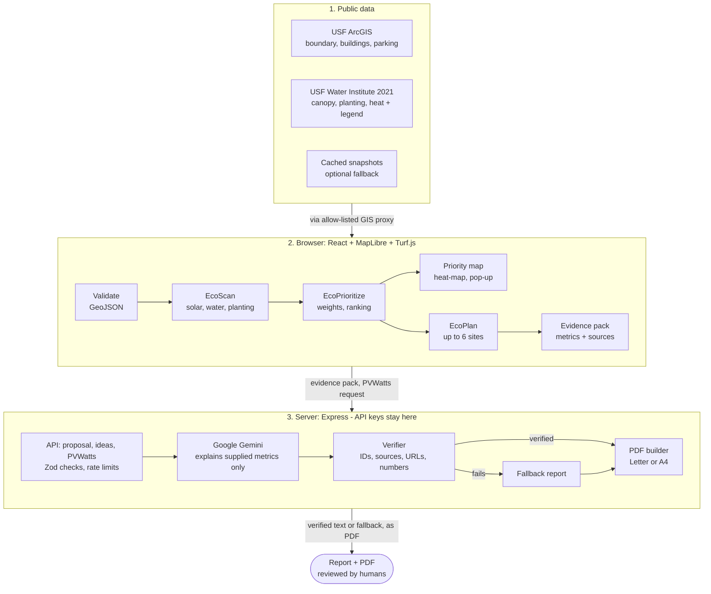
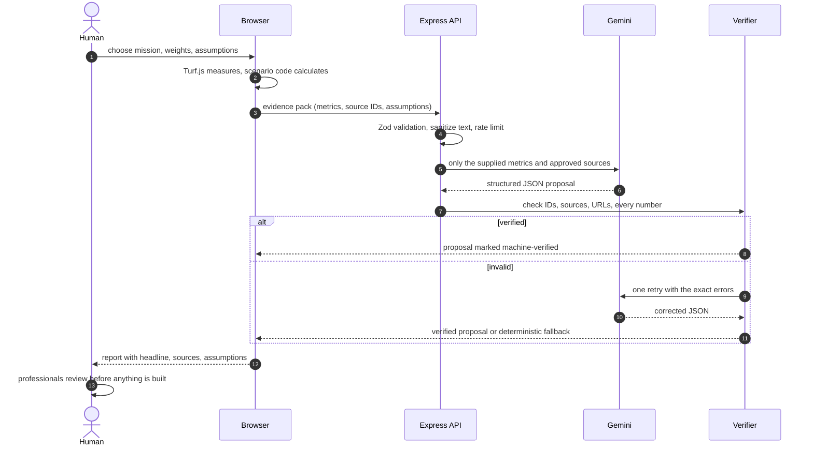

# BULLS ECOOPS — System Architecture

_Images for slides: [`architecture-overview.png`](architecture-overview.png) and [`architecture-ai-guardrail.png`](architecture-ai-guardrail.png)._

Evidence-first pipeline: **code measures, Gemini explains, a checker verifies, a human decides.**

## 1. System overview

> **Human decision at every step:** you choose the mission, the weights and the assumptions, and professionals review the report before anything is built.

## 2. The AI guardrail (why Gemini cannot invent numbers)

## 3. What lives where

| Layer | Folder | Responsibility |
|---|---|---|
| Shared logic | `shared/` | Source registry, scenario math, scoring, evidence pack, portfolio, proposal and brainstorm schemas, verifier, fallbacks |
| GIS engine | `src/lib/gis.js` | Buffers, canopy overlap, solar and water screening, open-space finder |
| Data loading | `src/lib/data.js` | ArcGIS queries, pagination, snapshot fallback, heat legend |
| UI | `src/components/` | Map, scan panel, planner, ideas, report |
| API server | `server/` | Express app, Gemini and PVWatts services, GIS proxy, PDF renderer |
| Tests | `tests/` | Math, GIS, guardrails, API, PDF |
| Snapshots | `scripts/snapshot.mjs` | Cache public GeoJSON with provenance |

## 4. Trust boundaries

- **Keys** (Gemini, NLR) exist only in the server environment, never in browser code.
- **Gemini** receives computed metrics and approved sources only. It never sees raw geometry and never calculates.
- **Every number** in a proposal must match a supplied metric or assumption, or the text is rejected.
- **Source registry** (`shared/sources.js`) is the only list of URLs a report may cite.
- **Scenario outputs** are labelled SCENARIO ESTIMATE. There is no cost, ROI or measured-benefit claim.
- **Data** is public and dated (2021 study layers); measurements are geodesic screening metrics, not surveyed.
